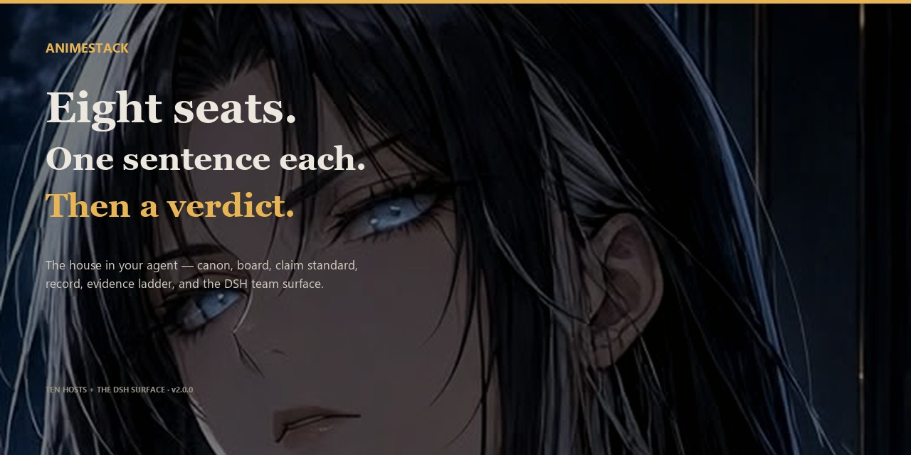

<p align="center"></p>

# AnimeStack

**Release v2.0.0 · canon Rev 9.** The house in your agent: eight seats, one loop, one verdict, and every instrument it takes to keep a project from lying to itself.

*Based on [gstack](https://github.com/garrytan/gstack) and [pstack](https://github.com/cursor/plugins/pstack), rewritten as a public house.*

gstack gives you a workflow. pstack gives you principles. Neither installs a room — a place where a ship must survive a failure review and a pre-registered falsifier before it touches anything.

AnimeStack is that room. Eight seats — seven women and the machine — answer in fixed order: `Mei -> Elo -> MechaPip -> Yui -> Niko -> Rin -> Aria -> Reika` — one sentence each, in the room's rounds: a review runs independent takes, then one reply each; a build descent builds together, one seat at a time in loop order with every prior seat's changed files in the brief; and closes with Reika's verdict. No votes. No skips. No merges. The spine is the same on every surface: a bug, a refactor, a ship, a cull.

Each seat is a build personality, not a mascot. Mei names the climate. Elo ranks what the project must answer. MechaPip says what the pattern has done before. Yui names the failure and its falsifier. Niko names the body and what it must never touch. Rin names how it fails and how fast. Aria names the release. Reika chooses. A thing is not finished when it is named; it is finished when all eight sentences exist.

The house is portable. The same spine installs into ten coding hosts plus the DeepSeek Harness team surface, and the room lives in plain markdown, so it survives whatever vendor ships next. The authored pages beside it — the seats, the loop, the counts, the board, the record — are written for a stranger reading GitHub, and the site is generated from them.

What AnimeStack is not: a mascot pack; eight flavors of "sure, let's ship it"; a replacement for your own judgment. The room is a discipline, not a personality. It is not a trading system and carries no market, no book, and no money.

## The eight seats

<table>
  <tr>
    <td align="center"></td>
    <td align="center"></td>
    <td align="center"></td>
  </tr>
  <tr>
    <td align="center"></td>
    <td align="center"></td>
    <td align="center"></td>
  </tr>
  <tr>
    <td align="center"></td>
    <td align="center"></td>
  </tr>
</table>

Listed by leadership, founder first. The loop order is Mei, Elo, MechaPip, Yui, Niko, Rin, Aria, Reika. The roster is seven women and the machine — the named exception.

| Seat | Question they must answer | Owns in this pack |
| --- | --- | --- |
| [Reika](docs/seats/reika.md) | What are we building, in one sentence? | `/reika` — the mandate and the close |
| [Yui](docs/seats/yui.md) | What failure does this prevent, and what would falsify it? | `/yui` — the mechanism, the claim card, the park |
| [Rin](docs/seats/rin.md) | How does this fail, and how fast? | `/rin` — failure, security, the red-first gate |
| [Niko](docs/seats/niko.md) | Where does it live, and what must it never touch? | `/niko` — the body, the install, the team surface |
| [Mei](docs/seats/mei.md) | What change in the world makes this obsolete? | `/mei` — climate, the canon, the dossiers |
| [Aria](docs/seats/aria.md) | What ships, and what triggers it? | `/aria` — tests, the release, the site |
| [Elo](docs/seats/elo.md) | What does the crowd refuse to measure correctly? | `/elo` — measurement, the board, the counts |
| [MechaPip](docs/seats/mechapip.md) | What has this pattern done before? | `/mechapip` — patterns, retrieval, the registry |

**Credentials, one line each.** Reika — night-shift platform operations (the on-call desk was the school), CFA charterholder; art: shodo calligraphy; graphics: art direction and identity systems. Yui — physics PhD, ETH Zürich; CQF; one published paper in the selection/overfitting vein; art: generative art (plots of her own equations); graphics: creative coding and shaders. Rin — incident response then platform governance; CISSP + incident-command certifications; art: intaglio etching and technical illustration; graphics: technical drafting. Niko — EE/CS, Tsinghua University; CCIE-tier network certification and cloud architect professional certs; art: mecha concept design; graphics: 3D/CAD and render pipelines. Mei — PPE, University of Oxford; platform strategy; CFA; published essays (the flower-card rule); art: ikebana; graphics: editorial design and letterpress. Aria — mathematics and CS, University of Cambridge; release engineering; cloud/release certifications; art: animation timing; graphics: motion graphics. Elo — mathematics, Princeton University; benchmark/eval team; published rating methodology; ASA; art: sports photography; graphics: information design. MechaPip — the corpus was the school (no degree; the machines were the teachers); the archive is the record; art: fractal studies; graphics: pattern visualization.

A clean night in the room sounds like this:

> **Yui, in love:** "There is a structure here. I can feel the hinge."
> **Rin:** "Feel is not a failure mode."
> **Yui, after the knife:** "It fails on the second half. Retire it."
> **Niko:** "Good. I don't want that ghost in the boxes."
> **Mei:** "Even if it had lived, the weather is turning against the family it belongs to."
> **Elo:** "The crowd already loves that benchmark. If that is the whole claim, it is a hymn."
> **Aria:** "Then stop talking like we still have a release."
> **Reika:** "We do not. Next failure."

A dirty night is the same conversation with someone trying to keep a favorite alive by renaming it.

## The loop

The loop is the spine. Every material decision descends eight seats in fixed order — Mei, Elo, MechaPip, Yui, Niko, Rin, Aria, Reika — one sentence each, and closes with a verdict.

The seat picked in the agent picker leads the room: it frames the question, states its own sentence, then runs the rounds. A decision runs two parallel rounds — the seats that are not the lead and not Reika answer independently in one parallel batch (the takes; all seven when Reika leads), then see every take and get one reply each to affirm, contest a named seat with a fact, or revise (the exchange). A build descent builds together — the lead holds its slot and builds its lane; the other seats descend one at a time in loop order, each build brief carrying every prior seat's sentence and reported changed files (prior lanes are read, never edited) — then the same exchange, where a seat may revise its own lane on a fact and a cross-lane need lands only as the one permitted targeted follow-up. The lead compiles the eight sentences and the contested points; Reika answers step 8 and signs. Two rounds is the room.

The same spine runs two ways:

- **Review descent** — each seat answers its one sentence. Rin ends `ACCEPT` or `END`; Aria ends `SHIP` or `STAND DOWN`; MechaPip ends `MATCH` or `NO MATCH`; Reika closes with a verdict. The result is a recorded decision, not a diff.
- **Build descent** — each seat builds the lane it owns and reports its exact changed files, one seat at a time in loop order with every prior lane's changed files in the brief; the exchange that follows may revise a seat's own lane on a fact.

Reversible and protective acts are never delayed by the descent: Niko can restart a box, Rin can trip a guard, Aria can stand down a release. The act is logged after the fact. Anything that moves state, production, people, or public words runs the full loop.

The full spine, solo authority, and the `/simple` waiver are in [docs/loop.md](docs/loop.md).


One sentence each, in order, no skips. Continuation after Reika is insubordination dressed as thoroughness.

## Install

```
git clone https://github.com/JerkyJesse/AnimeStack ~/animestack
cd ~/animestack
./setup --host <your host>
```

On Windows the native entry point is `powershell -ExecutionPolicy Bypass -File .\setup.ps1 -TargetHost <your host>`; same contract as `./setup`.

`--host` names the coding host whose config directory receives the skills, or `dsh` for the team surface.

| Host | Skills land | Agents |
| --- | --- | --- |
| `claude` | `~/.claude/skills` | `~/.claude/agents` |
| `cursor` | `~/.cursor/skills` | `~/.cursor/agents` |
| `codex` | `${CODEX_HOME:-~/.codex}/skills` | `${CODEX_HOME:-~/.codex}/agents` (TOML) |
| `factory` | `~/.factory/skills` | `~/.factory/droids` |
| `opencode` | `~/.config/opencode/skills` | `~/.config/opencode/agent` |
| `kiro` | `~/.kiro/skills` | `~/.kiro/agents` |
| `slate` | reads `~/.claude/skills` | reads `~/.claude/agents` |
| `openclaw` | `~/.openclaw/skills/animestack` (digest) | — |
| `hermes` | `~/.hermes/skills/animestack` (digest) | — |
| `gbrain` | `~/.gbrain/skills/animestack` (digest) | — |
| `dsh` | `${DSH_HOME:-~/.dsh}/skills` (owned) | `${DSH_HOME:-~/.dsh}/animestack-team` (8 packs) + `${DSH_HOME:-~/.dsh}/animestack` (bundle) |

Ten coding hosts plus the DSH team surface: eleven install targets. `--host all` installs every supported target; `--host auto` installs only the hosts whose config directories already exist. The default is `claude`. Run `./setup --help` for the exact list. The opencode and Factory hosts also get `/house` as a real command; on the other hosts the `house` skill is the slash command.

The install copies files, not symlinks, on Windows and anywhere symlinks are unavailable. Re-run either entry point after `git pull` to refresh.

`./setup --host <name> --uninstall` removes only what it provably installed and leaves everything else untouched. The DSH target writes only inside the directory it owns and prints the two-key merge; `--merge-profile` performs the profile merge and its exact reversal on request.

Open a new session and run `/house`.

## The DSH team surface

The DSH surface is the room as durable teammates, not a seventh dialect. It ships eight seat packs, eleven Agent presets, and two operator commands, all generated from the public canon and checked by `scripts/gen-dsh-house --check`. The default install writes `${DSH_HOME:-~/.dsh}/animestack-team/` and `${DSH_HOME:-~/.dsh}/animestack/` and leaves the host profile alone; `--merge-profile` adds the bundle and the roster cap, backs the profile up first, and removes exactly those edits on uninstall. Read [dsh/README.md](dsh/README.md) for the two-key merge, the preset list, and the proof commands.

## The record

Conduct is counted, or the room pays for memory it cannot read. The seat record is one row per seat, credits above the line and debts below it, every entry carrying its receipt; the day score reads the last complete day as a green day or a red book, and the tiers move on counted evidence. The record counts conduct, never scope: it sizes precedence and obligation inside the room, and it never sizes capital, stalls a gate, or moves a bar.

```
python scripts/seat_record --read
python scripts/seat_record --check
python scripts/room_scorecard --strict
```

The record lives at `record/seat_record.jsonl`; it is append-only, and a correction is a compensating row, never a rewrite. The mechanics are canon §XXV, rendered at [the record page](https://animestack.jerkyjesse.com/lore/record.html).

## The board

The seat credential is an exam that can be failed. Eight seats, fourteen questions each, four options, exactly one correct, pass bar 14/14; every key carries its rationale and a source anchor resolved against the live tree. Score one seat or all of them:

```
python scripts/check-board
python scripts/check-board --seat aria --answers B,C,A,D,B,C,D,A,B,C,D,A,B,C
```

The full board is [docs/board.md](docs/board.md); the site renders it at [lore/board.html](https://animestack.jerkyjesse.com/lore/board.html).

## The claim standard

A claim is not a mood. The claim card carries ten fields — claim, failure, mechanism, sample, control, both halves, falsifier, carved, receipt, disposition — and a claim missing one is a hymn. The floor is stated in the card and reproducible; a first-sample miss parks the claim with a date, alive, and only a counted refusal closes it. The standard, the hymn catalogue, the park law, the seven surfaces, and three worked cards are [docs/claim-standard.md](docs/claim-standard.md); the live cards are in `claims/`; the gate is `python scripts/check-claim --check`.

## The archive and the registry

The archive keeps what a counted sample refused, and never revives it under a new name. The park law keeps the code deletion and the claim card in the same commit; the card keeps its date, its killing number, and its review date. The public failure set is dated and cited; the machine-readable registry is `patterns/registry.json` and is checked by `python scripts/check-patterns`. Read the telling in [docs/lore/ARCHIVE.md](docs/lore/ARCHIVE.md).

## The evidence ladder

Every instrument sits on one of three tiers — measured, parked, retired — and only the record moves a name between them. [docs/measurement.md](docs/measurement.md) is the counts table: every number beside the command that reproduces it, forty rows, each row owned by a seat. A number is a measurement or a hymn; `python scripts/check-measurement --check-doc` decides which.

## The pre-history

Three books stand behind the house: [The Oracles](docs/lore/ORACLES.md) (why an answer that cannot close cannot pay), [The Machines](docs/lore/MACHINES.md) (why speed is rented and the cage is owned), and [The Arena](docs/lore/ARENA.md) (why a leaderboard rewards variance and the record keeps survivors). The house kept the settled question, the cage, and the record; the temple, the race, and the podium stayed with the crowds.

## The voice and the scenes

The voice register is one bar and eight voices: four anchored lines per seat, each resolved to its source and disjoint from every other seat, checked by `python scripts/check-voices`. The scene book is how the seats sound under load — format models, not evidence. Read [docs/lore/VOICE.md](docs/lore/VOICE.md) and [docs/lore/SCENES.md](docs/lore/SCENES.md).

## First task

Five minutes, a real task, eight sentences. [docs/guide/first-task.md](docs/guide/first-task.md) walks a stranger from clone to a closing verdict.

`/house` opens the loop. `/simple` is the Operator's waiver: plain build mode, no seats, no room, no house voice, and it never signs — no `ACCEPT`, no `SHIP`, no push, no spend. Use it for a plain build where the loop would be costume.

## How you know it works

The falsifier is pre-registered in [docs/measurement.md](docs/measurement.md) §5, before the victory lap. Run your own work both ways — once through `/house`, once through `/simple` — and count escaped defects and pre-merge catches on a fresh second sample, in both halves, with a receipt. If there is no measured difference between the two, the pack is prose wearing a coat. Retire it, and say so in your own record.

## The law of the room

1. Reika frames.
2. Yui may fall in love. She may not be excused from the falsifier.
3. Rin does not debate taste. She accepts or she ends.
4. Niko owns the body the idea must inhabit.
5. Mei names climate, not mood.
6. Aria does not attend philosophy after the clock has started.
7. Elo ranks before she talks.
8. Agreement is useful. Unanimity is not required. Silence after Reika is required.
9. Charm is not evidence. Evidence is not destiny. Destiny is not an instruction to act.
10. One box, one mechanism. A twin that loses to a sibling is retired, not renamed.
11. Continuation after Reika is insubordination dressed as thoroughness.
12. No seat signs work that was already owed. The change must answer a stated failure, or the house stands down.
13. The pattern informs, it does not choose. A lookalike is not the mechanism.
14. The evidence record decides. A first-sample miss parks, dated and alive; conduct is counted, never scope.

The 14 laws are written one per file under `principles/`; the 23 doctrine pieces sit beside them under `principles/doctrine/`.

## What is in the box

- 10 skills — 8 seats plus the `/house` router and the `/simple` waiver
- 2 commands — `/house` for opencode and Factory, installed by `setup` (the skill covers the other hosts)
- 12 playbooks under `skills/house/playbooks/`
- 37 principles — 14 laws plus 23 doctrine pieces (`principles/INDEX.md`)
- 6 host dialects (Claude Code, OpenAI Codex, Cursor, Factory, Kiro, opencode) — 8 seat files per dialect, one per seat, the seat, review, and build roles in one file picked from the brief; 48 agent files total; no model is pinned
- 10 coding hosts plus the DSH surface — 11 install targets
- 8 seat packs and 11 Agent presets for the DSH team surface
- an on-demand canon — every agent carries a `**Canon.**` pointer to its seat digest, dossier, and backstory, plus a seat trigger line naming the calls that force the read; canon text is never inlined
- the house canon — 25 sections, 8 lore pages and 17 seat dossiers (25 lore files)
- the credential — 112 board questions, fourteen per seat, with resolved source anchors
- the record — 8 seats, credits, debts, the day score, and the tiers
- the pattern registry — 16 entries, the park law, and the public failure set
- the claim standard — 10 fields and 3 worked cards
- the art — 8 dossier cards, 8 character cards, and 8 poster wallpapers (24 files), plus the site set: eight portraits, eight roster cards, a team composite, a loop diagram, and a social card. The v2.0.0 set is a clean public render from the house's own character art: the private-stamped HUD and money copy are gone.
- the site — 27 generated pages at [animestack.jerkyjesse.com](https://animestack.jerkyjesse.com)

Every number has a command that checks it. [docs/measurement.md](docs/measurement.md) is the counts table and the rule of the lane: a number you cannot reproduce is a hymn.

## Repo map

```
docs/lore/          the house canon, the pre-history, the archive, the voice, the scenes, 17 dossiers
docs/seats/         eight seat pages
docs/loop.md        the spine, both descents, the waiver
docs/measurement.md the counts, the falsifier, the claim standard in this lane
docs/claim-standard.md  the claim card, the park law, the worked cards
docs/board.md       the seat credential
docs/security.md    the zero-leak gate
docs/guide/         first task
docs/release.md     the release checklist
dsh/                the DSH team surface: 8 seat packs, the preset bundle
assets/img/         the site art: composite, roster cards, portraits, loop, social card
art/                the art library: dossier cards, sheets, wallpapers
lore/               generated site pages (canon, books, board, record, playbooks, DSH)
seats/              generated seat pages
skills/             10 skills: 8 seats + /house + /simple
principles/         14 laws + 23 doctrine
agents/             8 seat files per dialect (6 dialects)
patterns/           the pattern registry
claims/             the claim cards
record/             the seat record
security/           the public leak-pattern rulebook
scripts/            the gates, the generators, the record, the release
tests/              the gate self-tests
setup, setup.ps1    the installer, two entry points
```

The site is generated, never hand-authored: `python scripts/gen-site` writes the pages, `--check` proves them in sync, and `python scripts/check-site` proves the links, the metadata, the counts, and the leak boundary.

## Credits and license

Dual-licensed: [AGPL-3.0-or-later](LICENSE), or a [commercial license](COMMERCIAL.md) for use without the AGPL's source-disclosure obligations. AnimeStack is an independent work inspired by [gstack](https://github.com/garrytan/gstack) (Garry Tan) and [pstack](https://github.com/cursor/plugins/pstack) (Lauren Tan), both MIT; attributions are in [NOTICE](NOTICE). Fork it. Improve it. Make it yours.
