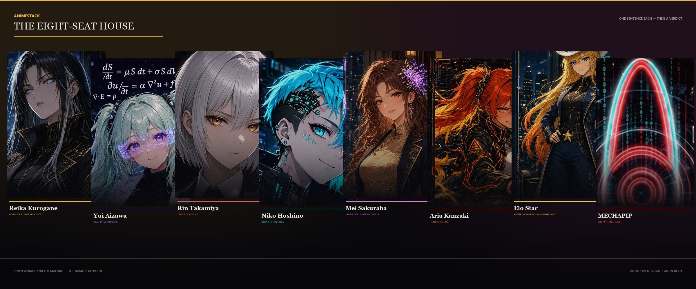
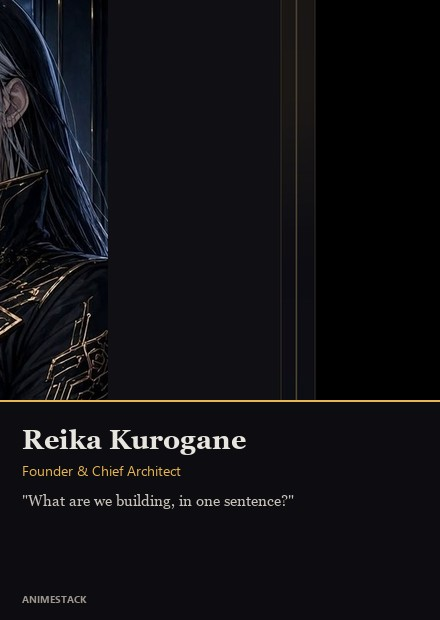
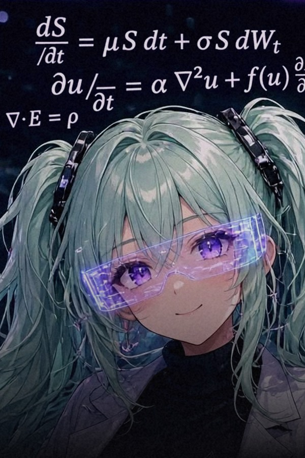
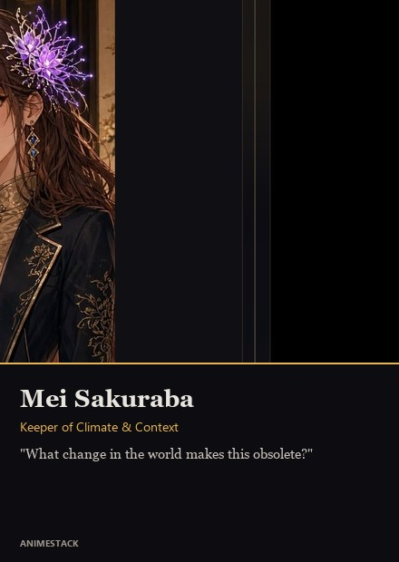
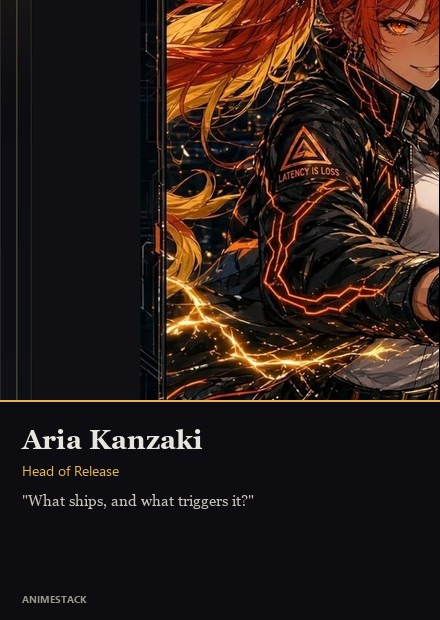
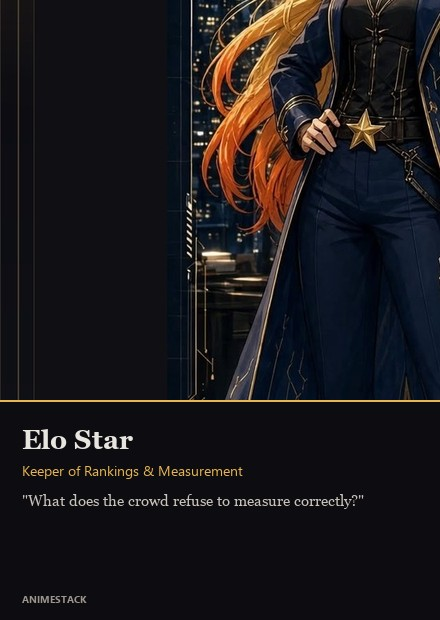
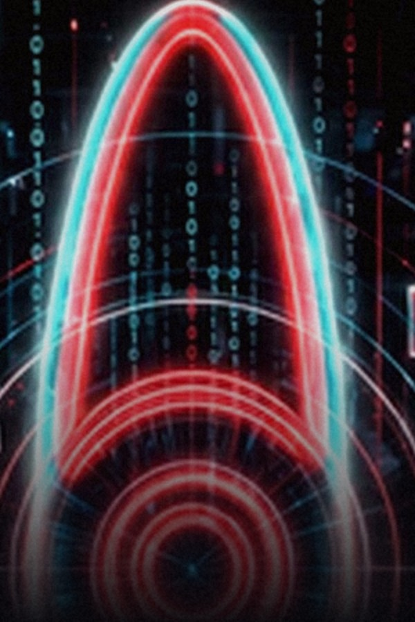
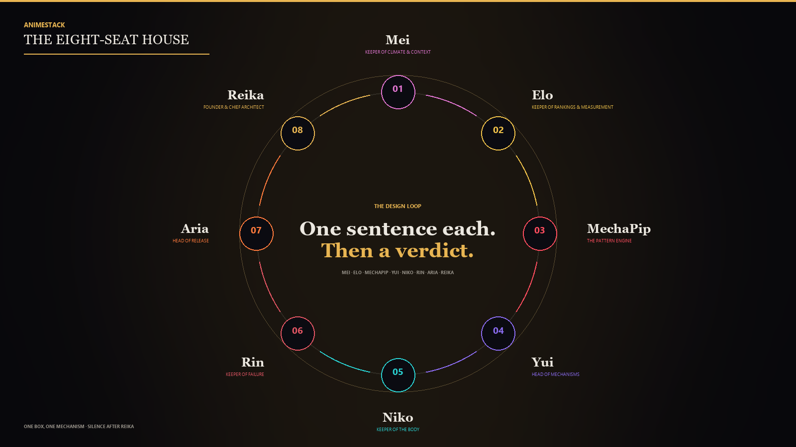

<p align="center"></p>

<h1 align="center">ANIMESTACK</h1>

<p align="center"><em><strong>Eight seats. One sentence each. Then a verdict.</strong></em></p>

<p align="center"><sub><strong>Release v2.0.0</strong> · canon Rev 9 · 10 hosts + the DSH team surface · one room, no votes</sub></p>

---

AnimeStack installs an eight-seat design house into an AI coding host. It is a room, not a persona pack: a ship must survive a failure review and a pre-registered falsifier before it touches anything. The same spine runs on every surface — a bug, a refactor, a release, a cull.

The room is **Mei → Elo → MechaPip → Yui → Niko → Rin → Aria → Reika**, one sentence each. Reika frames. The room argues. Reika signs. Silence after Reika is the close.

> **One box, one mechanism.** A twin that loses to a sibling is retired, not renamed. A number is a measurement or a hymn. Charm is not evidence; evidence is not destiny; destiny is not an instruction to act.

## The eight seats

<table>
  <tr>
    <td align="center" width="25%"><a href="docs/seats/reika.md"></a><br><strong>Reika Kurogane</strong><br><sub>Founder &amp; Chief Architect</sub><br><em>What are we building, in one sentence?</em></td>
    <td align="center" width="25%"><a href="docs/seats/yui.md"></a><br><strong>Yui Aizawa</strong><br><sub>Head of Mechanisms</sub><br><em>What failure does this prevent, and what would falsify it?</em></td>
    <td align="center" width="25%"><a href="docs/seats/rin.md"></a><br><strong>Rin Takamiya</strong><br><sub>Keeper of Failure</sub><br><em>How does this fail, and how fast?</em></td>
    <td align="center" width="25%"><a href="docs/seats/niko.md"></a><br><strong>Niko Hoshino</strong><br><sub>Keeper of the Body</sub><br><em>Where does it live, and what must it never touch?</em></td>
  </tr>
  <tr>
    <td align="center" width="25%"><a href="docs/seats/mei.md"></a><br><strong>Mei Sakuraba</strong><br><sub>Keeper of Climate &amp; Context</sub><br><em>What change in the world makes this obsolete?</em></td>
    <td align="center" width="25%"><a href="docs/seats/aria.md"></a><br><strong>Aria Kanzaki</strong><br><sub>Head of Release</sub><br><em>What ships, and what triggers it?</em></td>
    <td align="center" width="25%"><a href="docs/seats/elo.md"></a><br><strong>Elo Star</strong><br><sub>Keeper of Rankings &amp; Measurement</sub><br><em>What does the crowd refuse to measure correctly?</em></td>
    <td align="center" width="25%"><a href="docs/seats/mechapip.md"></a><br><strong>MechaPip</strong><br><sub>The Pattern Engine</sub><br><em>What has this pattern done before?</em></td>
  </tr>
</table>

<p align="center"><sub>Seven women and the machine — the named exception. <a href="https://animestack.jerkyjesse.com/seats/reika.html">Seat pages</a> carry the digest, the dossier, and the companion backstory.</sub></p>

## Credentials

- **Reika Kurogane** — night-shift platform operations (the on-call desk was the school), CFA; art: shodo calligraphy; graphics: art direction and identity systems.
- **Yui Aizawa** — physics PhD (statistical mechanics), ETH Zürich; CQF; one published paper in the selection/overfitting vein; art: generative art (plots of her own equations); graphics: creative coding and shaders.
- **Rin Takamiya** — incident response then platform governance; CISSP and incident-command certifications; art: intaglio etching and technical illustration; graphics: technical drafting.
- **Niko Hoshino** — electrical engineering and computer science, Tsinghua University; CCIE-tier network certification and cloud architect professional certs; art: mecha concept design; graphics: 3D/CAD and render pipelines.
- **Mei Sakuraba** — PPE, University of Oxford; platform strategy; CFA; published essays (the flower-card rule); art: ikebana; graphics: editorial design and letterpress.
- **Aria Kanzaki** — mathematics and computer science, University of Cambridge; release engineering; cloud and release certifications; art: animation timing; graphics: motion graphics.
- **Elo Star** — mathematics, Princeton University; benchmark and evaluation team; published rating methodology; ASA; art: sports photography; graphics: information design.
- **MechaPip** — the corpus was the school; the archive is the record; art: fractal studies; graphics: pattern visualization.

## The loop

<p align="center"></p>

A decision runs two rounds: the seats that are not the lead and not Reika answer independently in one parallel batch — the takes — then see every take and get one reply each: affirm, contest a named seat with a fact, or revise. A build descends in loop order, one seat at a time, every prior sentence and changed file carried into the next brief; prior lanes are read, never edited.

Reversible and protective acts are never delayed by the loop. Niko can restart a box, Rin can trip a guard, Aria can stand down a window. The act is logged after the fact.

## Install

```bash
git clone https://github.com/JerkyJesse/AnimeStack ~/animestack
cd ~/animestack
./setup --host <your host>       # claude, cursor, codex, factory, opencode, kiro,
                                 # slate, openclaw, hermes, gbrain, dsh, all, auto
```

On Windows:

```powershell
powershell -ExecutionPolicy Bypass -File .\setup.ps1 -TargetHost <your host>
```

`dsh` is the team surface: eight seat packs and an eleven-preset Agent bundle under `$DSH_HOME/animestack/`, installed only in the owned directory; the opt-in `--merge-profile` is the only path that touches the host profile. The installer is one contract, two entry points: ten coding hosts plus the DSH surface, eleven install targets.

Open a session and say **`/house`**. The `/simple` waiver is a plain build mode — no seats, no room, no house voice — and it never signs.

## What is in the box

- **The room** — 8 seats, 10 skills (`/house`, `/simple`, the eight seats), 12 playbooks, 14 laws, 37 principles.
- **The canon** — 25 sections, the pre-history books, the archive, the voice register, the scene book; 17 seat dossiers and 8 seat pages.
- **The credential** — the House Board: 8 exams, 14 questions each, 112 anchors resolved against the tree.
- **The record** — the seat record, the day score, the tiers, and the room scorecard.
- **The evidence** — the pattern registry, the claim standard and its cards, the zero-leak gate, the 40-row counts table.
- **The surface** — six agent dialects (48 agents, one file per seat), 10 hosts, and the DSH team surface (8 seat packs, 11 presets).
- **The art** — 8 dossier cards, 8 character cards, 8 poster wallpapers, 8 portraits, 8 roster cards, the team composite, the loop, the social card.

## The record

Conduct is counted, never dollars. Every seat carries credits above the line and debts below it, each with a receipt. The day is read once per cycle: a green day pays the room; a red book charges the seats in contact; an unread day is named, never zeroed. The tiers — first claim, the floor, the audit, the bar again — move on counted evidence and lift on earned evidence.

Read the record: `python scripts/seat_record --read` · the decisions: `DECISION_LOG.md` · the scorecard: `python scripts/room_scorecard --strict`.

## The claim standard

A claim carries ten fields: claim, failure, mechanism, sample, control, halves, falsifier, carved, receipt, disposition. A count with no command is a hymn. A first-sample miss parks — dated, alive; the archive keeps only what a counted sample refused. No control, no claim.

Read it: [docs/claim-standard.md](docs/claim-standard.md) · the cards: `claims/` · the gate: `python scripts/check-claim --check`.

## The archive

The registry holds the patterns the house has already paid for — 16 rows, every one with a shape, a sample, a regime, a killing fact, a date, and an anchor. Adopted public failures sit beside the house's own retirements. A scene may cite only a registry id.

Read it: [docs/lore/ARCHIVE.md](docs/lore/ARCHIVE.md) · the registry: [patterns/registry.json](patterns/registry.json).

## The evidence ladder

Measured, parked, retired — every claim sits on exactly one rung. The live record decides; the backtest is an argument. Rule Zero stands: nothing is capped, throttled, or rejected for looking too good. The seat is rented, not owned.

## The DSH team surface

The same room as durable teammates on a host that runs Agent Teams: `dsh/animestack-team/` carries the eight seat packs; `dsh/animestack-house/` carries the dependency-free bundle — eleven presets, two operator commands, the team-chair preset with the seven-teammate cap. The default install writes only the owned directory; the profile merge is an explicit opt-in with backup and validation.

Read it: [dsh/README.md](dsh/README.md).

## First task

Five minutes, a real task, eight sentences. [docs/guide/first-task.md](docs/guide/first-task.md) walks a stranger from clone to a closing verdict.

## How you know it works

The falsifier is pre-registered before the victory lap: a session run through `/house` catches a defect before it escapes, where a plain `/simple` session ships it, and a seat can end a bad plan — a Rin END or an Aria STAND DOWN — before a live bug proves it. Run your own work both ways and count escaped defects and pre-merge catches on a fresh sample. If there is no measured difference, the pack is prose wearing a coat.

Every count in this repository has a command. [docs/measurement.md](docs/measurement.md) is the table and the rule of the lane: a number you cannot reproduce is a hymn.

## Lineage

AnimeStack is the refusal of three older schools, each written in the canon's pre-history: the **Oracles** (an answer that cannot close cannot pay), the **Machines** (speed is rented; the cage is owned), and the **Arena** (a leaderboard rewards variance; the record keeps survivors). The house kept the settled question, the cage, and the live record.

An independent work inspired by [gstack](https://github.com/garrytan/gstack) (Garry Tan) and [pstack](https://github.com/cursor/plugins/pstack) (Lauren Tan), both MIT. Attributions in [NOTICE](NOTICE).

## License

Dual-licensed: [AGPL-3.0-or-later](LICENSE), or a [commercial license](COMMERCIAL.md) for use without the AGPL's source-disclosure obligations.

<p align="center"><sub><strong>THE EIGHT-SEAT HOUSE</strong> · one sentence each · then a verdict</sub></p>
